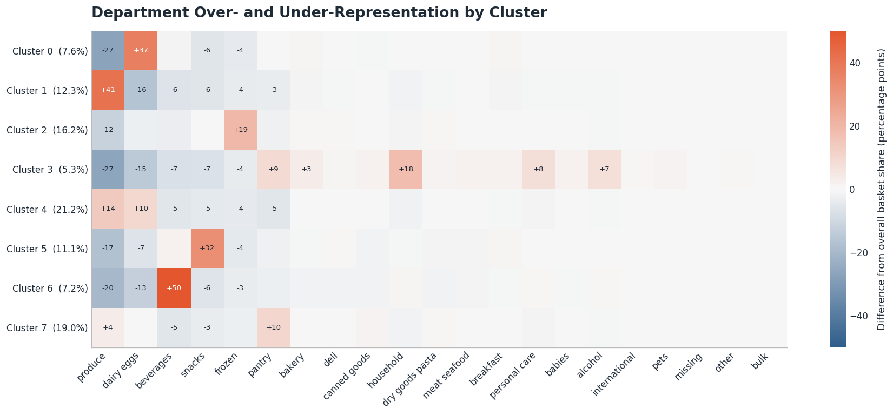
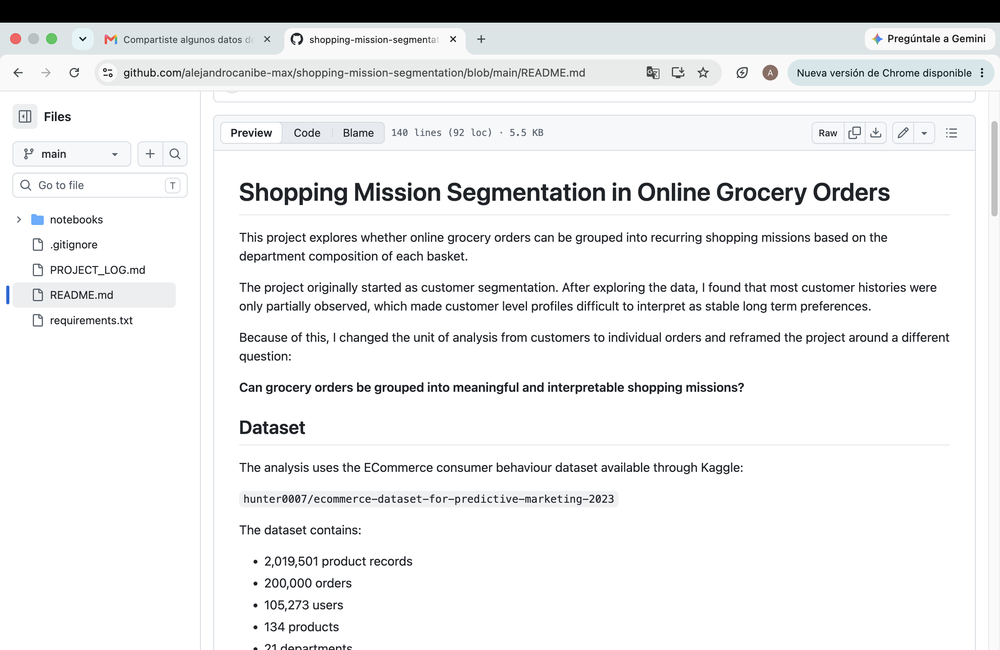
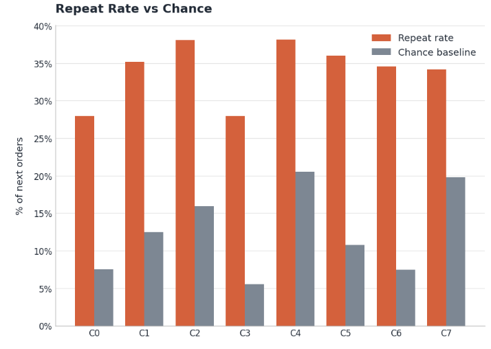

# Shopping Mission Segmentation in Online Grocery Orders

This project studies whether online grocery orders can be grouped into recurring shopping missions using the department composition of each basket.

The work originally began as a customer segmentation problem. During exploratory analysis, however, most customer histories were found to be only partially observed, making customer-level profiles difficult to interpret as stable long-term preferences.

The unit of analysis was therefore changed from customers to individual orders, leading to a different research question:

**Can grocery orders be grouped into meaningful and interpretable shopping missions?**

## Dataset

The analysis uses the ECommerce consumer behaviour dataset available through Kaggle:

`hunter0007/ecommerce-dataset-for-predictive-marketing-2023`

The dataset contains:

- 2,019,501 product records
- 200,000 orders
- 105,273 users
- 134 products
- 21 departments

Each row represents one product contained within an order.

The dataset is downloaded automatically at runtime using `kagglehub`, so the raw data file is not stored in this repository.

## Why the project changed direction

The initial approach attempted to segment customers based on their department preferences.

Exploration of the dataset showed that:

- 54.9% of users have only one observed order
- 78.4% have two observed orders or fewer
- approximately 93.6% of users show evidence of missing orders from their broader purchase history

These observed orders therefore do not represent complete customer histories.

Rather than forcing customer segmentation onto incomplete longitudinal data, the analysis moved to the order level, where each basket can be treated as a complete shopping event.

## Method

Each order was converted into a vector containing the proportion of products purchased from each of the 21 departments.

The main modeling pipeline was:

1. build order-level department proportions
2. apply a Hellinger transformation
3. compare raw and transformed representations with PCA
4. reduce the transformed data to 7 principal components
5. evaluate K-Means solutions from 2 to 10 clusters
6. select and profile an 8-cluster solution
7. test robustness against alternative representations, small baskets, and random initialization
8. examine behavioral differences between missions
9. study mission persistence across consecutively observed customer orders

The final model uses:

- Hellinger transformed department proportions
- 7 principal components
- 8 K-Means clusters
- 50 random initializations

## Shopping missions

The final segmentation produced eight recurring basket profiles:

| Cluster | Shopping Mission |
| --- | --- |
| 0 | Dairy Core |
| 1 | Produce Core |
| 2 | Frozen Variety |
| 3 | Household Pantry |
| 4 | Fresh Essentials |
| 5 | Snack Basket |
| 6 | Beverage Basket |
| 7 | Pantry Staples |

The names describe the structure of the baskets rather than assumed customer intent.

They are intended to be descriptive and interpretable labels, not definitive behavioral categories.

For example, Frozen Variety contains a strong frozen component while also containing relatively large and diverse baskets. Beverage Basket is smaller and much more concentrated.

## Cluster profiles

The department profiles show how each mission differs from the average grocery order.



## Main findings

Key takeaways:

- the final 8-cluster solution produced interpretable basket profiles
- the clusters capture more than the single largest department in each order
- basket size, department diversity, and reorder rate differ more clearly between missions than order timing variables
- shopping missions show partial persistence across visits, but customers often switch between missions over time

Approximately 23.6% of orders contain a tie for their largest department share.

Several missions also share the same most common dominant department while maintaining different overall basket profiles.

This suggests that the clustering captures relationships between departments rather than simply reproducing the largest category in each basket.

The missions also differ in behavioral characteristics.

Basket size, department diversity, and mean item reorder rate vary meaningfully between groups, while order hour and time since the previous observed purchase show much smaller differences.

The final model has a silhouette score of approximately 0.17. This is modest, but it is consistent with the idea that grocery shopping behavior overlaps rather than forming sharply separated groups.

## Behavioral differences

Basket structure provides clearer differences between missions than temporal variables.



Robustness checks showed that:

- PCA improves geometric separation compared with clustering directly on all 21 Hellinger features
- most mission profiles remain similar after removing very small baskets
- one mission, Household Pantry, appears more sensitive to the inclusion of very small baskets
- the final K-Means solution is highly stable across random seeds, with Adjusted Rand Index values between approximately 0.94 and 0.98

## Mission persistence

For the subset of users with consecutively observed orders, the same shopping mission is repeated in approximately 35.2% of transitions.

Every mission has a repeat rate above its corresponding chance baseline.

At the same time, most transitions move to a different mission.



This suggests that shopping missions are better understood as recurring types of shopping events rather than permanent customer segments.

A single customer may perform different types of shopping trips over time.

## Limitations

The shopping missions should be interpreted as descriptive patterns rather than direct observations of customer intent.

Some important limitations are:

- customer histories are incomplete for most users
- the clustering has a modest silhouette score and the groups overlap
- one mission is more sensitive to very small baskets
- the analysis is performed at department level rather than detailed product level
- price, total spending, and promotion information are not available
- K-Means assigns every order to one group even when some baskets may lie between several patterns

## Project background and collaboration

The original version of this project was developed as a class assignment in collaboration with **Sofia Valeria Ramirez Moreno**.

That first version explored customer segmentation using department-level purchase behavior.

The current repository is an extended and redesigned version of that work. The main changes include:

- changing the unit of analysis from customers to individual orders
- treating basket composition as compositional data
- revising the PCA and clustering methodology
- adding robustness and sensitivity checks
- profiling behavioral differences between shopping missions
- analyzing mission persistence across consecutively observed orders
- expanding the methodological documentation and interpretation

Credit for the original classroom project is shared with Sofia Valeria Ramirez Moreno. The redesign, additional analysis, validation, and documentation presented in this repository were developed afterward as an independent extension.

## Repository structure

```text
shopping-mission-segmentation/
│
├── README.md
├── PROJECT_LOG.md
├── requirements.txt
├── .gitignore
│
├── notebooks/
│   └── shopping_mission_segmentation.ipynb
│
└── figures/
    ├── cluster_profile_heatmap.png
    ├── behavioral_profile.png
    └── mission_persistence.png
```

## Files

The complete analysis is available here:

[Open the analysis notebook](notebooks/shopping_mission_segmentation.ipynb)

The main methodological decisions and changes made during the project are documented here:

[Read the project decision log](PROJECT_LOG.md)

## Reproducing the analysis

Install the required packages:

```bash
pip install -r requirements.txt
```

Then open:

```text
notebooks/shopping_mission_segmentation.ipynb
```

The dataset will be downloaded automatically at runtime using `kagglehub`.

## Tools

Python, pandas, NumPy, Matplotlib, scikit-learn, KaggleHub
